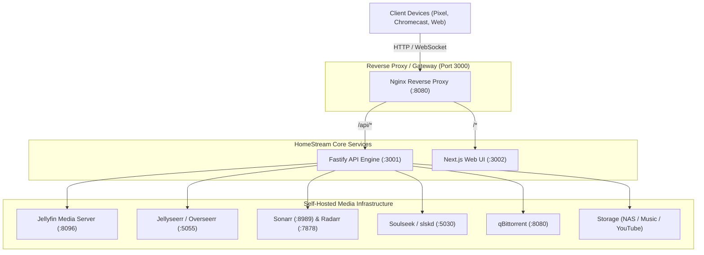

# HomeStream System Architecture

HomeStream is a self-hosted modern streaming media ecosystem designed to deliver a Netflix-like streaming experience on smart TVs, mobile devices, and the web, powered by your local media server and automated download infrastructure.

---

## Service Breakdown

### 1. Gateway (`nginx`)
- **Port**: `3000` (internal `8080`)
- **Function**: Unified entry point for all incoming client traffic.
- **Routing**:
  - `/api/*`: Routed to the Fastify backend on port 3001 with buffering disabled for real-time video/audio transcode streams.
  - `/*`: Routed to the Next.js standalone web frontend on port 3002 with WebSocket upgrade support.
  - Client IP verification & LAN direct pairing authorization.

### 2. Fastify Backend (`homestream-backend`)
- **Port**: `3001`
- **Repo**: [Eckobrew/homestream-backend](https://github.com/Eckobrew/homestream-backend)
- **Runtime**: Node.js 22 LTS with Fastify
- **Features**:
  - Jellyfin authentication, library synchronization, and live playback reporting.
  - Hardware-accelerated HLS video transcoding (Intel QuickSync / VA-API / NVENC).
  - Native TMDB integration with Overseerr/Jellyseerr automated request fulfillment.
  - YouTube hub with continuous feed recommendations, NAS background archiver, and `yt-dlp` stream proxy.
  - Spotify-style music hub with per-profile library isolation, Soulseek/slskd integration, embedded ID3 APIC extraction, and iTunes cover caching.
  - Multi-profile access control with kids rating tiers (U, PG, 12, 15, 18) and parental PIN validation.
  - Bookshelf catalog access, per-profile shelves and reading progress, and an imported library mounted at `/books`.
  - Mobile REST & WebSocket API (`/api/mobile/v1/*`).

### 3. Next.js Web UI (`homestream-web`)
- **Port**: `3002`
- **Repo**: [Eckobrew/homestream-web](https://github.com/Eckobrew/homestream-web)
- **Runtime**: Next.js 15 (React 19, Tailwind CSS)
- **Features**:
  - Netflix-inspired browsing, responsive hero banners, and category carousels.
  - Dedicated full-bleed YouTube hub with edge-to-edge thumbnails.
  - Spotify-styled music player with mini-bar, scrubber, and queue management.
  - Embedded HLS.js custom media player with auto-resume, subtitle selection, and audio track switching.
  - Responsive EPUB and PDF reader with animated page turns.
  - Google Cast sender integration.

### 4. Native Android & Android TV Client (`homestream-android`)
- **Repo**: [Eckobrew/Homestream-android](https://github.com/Eckobrew/Homestream-android)
- **Runtime**: Kotlin Android SDK (minSdk 26, targetSdk 35)
- **Features**:
  - Unified APK supporting both Android Phones (e.g., Pixel 8a) and Android TV / Google TV (e.g., Chromecast HD).
  - Dynamic Floating Bottom Navigation Pill that morphs between Main, YouTube, and Music hub tabs.
  - Direct QR/LAN pairing and remote Jellyfin token authentication.
  - Native ExoPlayer / Media3 with hardware decoding and background music playback service.
